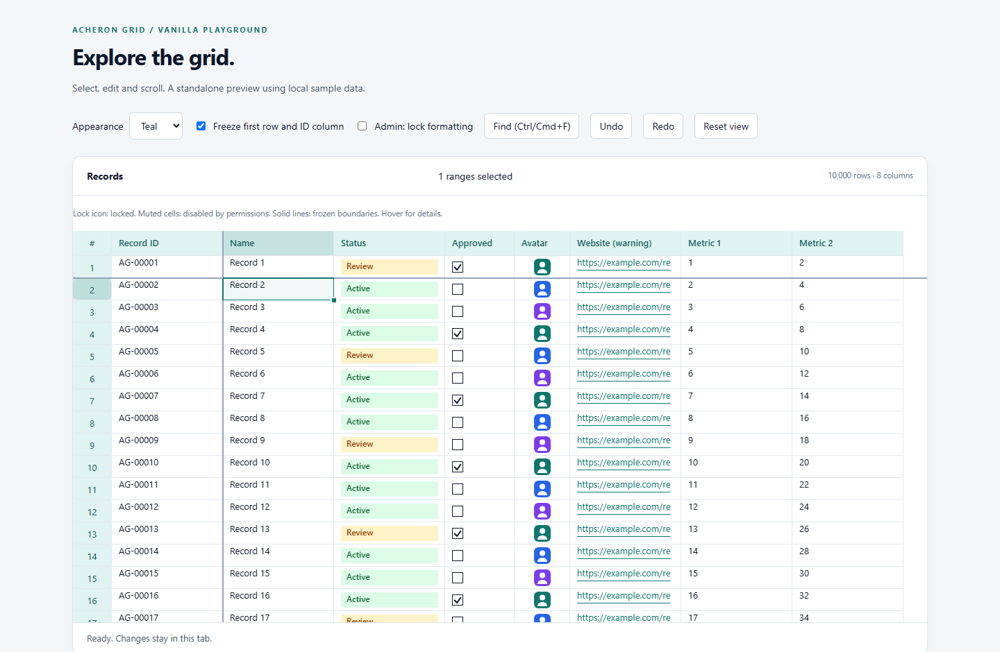

# Acheron Grid

> Your data. Your rules.

A TypeScript data grid with a headless core, Canvas rendering, and React and Vue adapters. The engine manages data commands, selection, permissions, layout and history; Canvas adds the browser interface.

[Live demo and documentation](https://acheron-grid.haoduong.dev/) · [Getting started](guides/getting-started.md) · [Integration guide](guides/integration.md) · [Release notes](RELEASE-0.4.0.md)

[](https://acheron-grid.haoduong.dev/)

_The standalone playground with local sample data. Its 10,000-row dataset is a demonstration workload, not a performance guarantee._

All features and optional modules are open source and free to use. There are no premium feature gates or license keys.

## Status

**0.4.0 development preview is published on npm for all eight packages.** Exact registry consumers and trusted-publishing provenance are verified. Published 0.3.0 and earlier artifacts remain available and immutable. Install matching Acheron package versions. APIs remain experimental; this is not a stable 1.0 release.

This release adds local grouping/tree views, bounded row refresh/epoch reset and remote viewport observation/editing, building on the existing mutation recovery. Existing APIs/export paths remain; the new APIs are additive. See [changes and migration](RELEASE-0.4.0.md), the [changelog](CHANGELOG.md) and the [1.0 acceptance policy](guides/v1-readiness.md).

The [v0.4.0 release workflow](https://github.com/haodn-dev/acheron-grid/actions/runs/40656005979) passed Node 22/24, Chromium, portable Firefox/WebKit, independent packed and exact npm-version consumers. All eight 0.4.0 artifacts have trusted-publishing provenance. Manual screen-reader, physical-device and production-host acceptance remain open.

The 0.4.0 additions are **not included in npm 0.3.0**. Install matching 0.4.0 packages; see the [0.4.0 changelog](CHANGELOG.md), [grouping example](examples/grouping/README.md), [tree example](examples/tree/README.md) and [remote viewport examples](examples/paged/README.md). See the release notes for migration and limits.

## Start here

Use **core** for Node.js, a custom renderer or a headless data workflow. Add **Canvas** for an interactive browser grid. React and Vue wrap the same Canvas renderer and data contracts.

The [package references](#packages) describe each module. The [practical guide](examples/vanilla/practical-guide.md) covers editing, clipboard, local views and keyboard interaction; the [integration guide](guides/integration.md) covers application lifecycle and customization. When reading the website, select the documentation channel that matches your installed version; [documentation versions](guides/versions.md) explains the distinction between released packages and source previews.

## Quick start

Install core and Canvas in an ESM application with a bundler:

```sh
npm install @acheron-grid/core@0.4.0 @acheron-grid/canvas@0.4.0
```

Give the container explicit dimensions:

```html
<div id="grid" style="width:100%;height:480px"></div>
```

Mount the grid from your browser entry module:

```ts
import { LocalDataSource } from '@acheron-grid/core';
import { createGrid } from '@acheron-grid/canvas';

const container = document.querySelector<HTMLElement>('#grid');
if (!container) throw new Error('Missing #grid container.');

const source = new LocalDataSource([
  { id: 'r1', name: 'Ada' },
  { id: 'r2', name: 'Lin' },
], row => row.id);

const grid = createGrid({
  container,
  columns: [{ key: 'name', title: 'Name', editable: true }],
  dataSource: source,
});

// Call when the owning view unmounts.
// grid.destroy();
```

Canvas requires a browser with Canvas 2D and ResizeObserver. Core can run without the DOM; `@acheron-grid/core/headless` remains an alias for its headless API. See [core setup](packages/core/README.md#quick-start) and [Canvas setup](packages/canvas/README.md).

For React or Vue, add the matching adapter and supply its framework peer dependency:

```sh
npm install @acheron-grid/react@0.4.0 react react-dom
# Or, for Vue:
npm install @acheron-grid/vue@0.4.0 vue
```

Follow the [React](packages/react/README.md) or [Vue](packages/vue/README.md) mounting example. The adapters do not bundle their frameworks; React 18.3/19 and Vue 3.5 within Vue 3 are supported peer ranges.

## Packages

| Package                                               | Purpose                                                                     | Runtime dependencies          | npm                                                                                                                                            |
| ----------------------------------------------------- | --------------------------------------------------------------------------- | ----------------------------- | ---------------------------------------------------------------------------------------------------------------------------------------------- |
| [@acheron-grid/core](packages/core/README.md)         | Headless engine, synchronous sources and local row views; usable in Node.js | None                          | [](https://www.npmjs.com/package/@acheron-grid/core)             |
| [@acheron-grid/canvas](packages/canvas/README.md)     | Browser rendering and interactions                                          | @acheron-grid/core            | [](https://www.npmjs.com/package/@acheron-grid/canvas)       |
| [@acheron-grid/markdown](packages/markdown/README.md) | Optional Markdown parsing adapter                                           | marked                        | [](https://www.npmjs.com/package/@acheron-grid/markdown) |
| [@acheron-grid/react](packages/react/README.md)       | React lifecycle adapter                                                     | Canvas; React peer dependency | [](https://www.npmjs.com/package/@acheron-grid/react)          |
| [@acheron-grid/vue](packages/vue/README.md)           | Vue 3 lifecycle adapter                                                     | Canvas; Vue peer dependency   | [](https://www.npmjs.com/package/@acheron-grid/vue)                |
| [@acheron-grid/mcp](packages/mcp/README.md)           | Optional documentation server and host-authorized grid tools                | MCP SDK; @acheron-grid/core   | [](https://www.npmjs.com/package/@acheron-grid/mcp)                |
| [@acheron-grid/export](packages/export/README.md)     | Optional CSV/XLSX selection and authorized HTML table export                | @acheron-grid/core; fflate    | [](https://www.npmjs.com/package/@acheron-grid/export)       |
| [@acheron-grid/charts](packages/charts/README.md)     | Optional inline line/area/column/bar charts                                 | @acheron-grid/canvas          | [](https://www.npmjs.com/package/@acheron-grid/charts)       |

Install only the modules you use. The core package has no runtime dependencies and does not import Canvas or either framework adapter.

## Implemented features

- **Viewport and layout:** virtualized rows/columns, frozen panes, resize guides, auto-fit, hidden axes and configurable themes.
- **Selection and clipboard:** cell/range/row/column selection, multiple ranges, keyboard navigation, TSV and structured clipboard, paste special, staged cut/paste and bounded find/replace.
- **Editing:** text, choices, tags, checkboxes, multiline and rich-text editors; parsing and validation; media galleries, people cells and custom renderers/editors.
- **Data commands:** atomic updates, bounded undo/redo, structural row/column commands, merged cells, manual row groups and sparse formatting.
- **Views and persistence:** local multi-column sorting/filtering, versioned layout/domain state, external-data reconciliation and stable row identities.
- **Remote data:** read-only async paging, bounded snapshot writes, writable paged sources, revision/query snapshots and a bounded read-only live cache.
- **Optional modules:** Markdown parsing, CSV/XLSX and authorized HTML table export, inline line/area/column/bar charts, and MCP documentation/host tools.
- **Browser interaction:** searchable menus, contextual suggestions, host-loaded link metadata, reduced-motion support, an active-cell ARIA mirror and an opt-in bounded viewport accessibility tree.

Core-managed local views preserve mapped selection, history and sparse state. Host-managed projections have a separate contract. Rendering virtualization does not remove the CPU or memory cost of storing, sorting or filtering a dataset.

## Integration examples

Columns provide parsing and validation; editor/paste text uses parsers, while programmatic updates accept typed values. Invalid input is rejected by default. Call `refreshData` after external source changes and `destroy` during teardown; mutating application data does not automatically refresh a mounted grid.

Application callbacks control choices, custom drawing/editors, uploads and URL metadata. Grid permissions and locks control client interactions; authentication, server authorization, durable storage and remote validation belong to the host application. Only send authorized data to the browser.

Use the focused guides for complete examples and limits:

- [Core data and lifecycle](packages/core/README.md#data-and-lifecycle) and [integration](guides/integration.md).
- [Canvas recipes](guides/canvas-recipes.md): editors, media, menus, link previews and cleanup.
- [Editing and remote writes](guides/editing-and-remote.md) and [writable paged sources](guides/paged-remote.md).
- [Cooperative bulk commands and TSV Worker decoding](guides/bulk-commands.md).
- [Export](packages/export/README.md), [inline charts](packages/charts/README.md) and [MCP](packages/mcp/README.md).

## Optional MCP adapter

`@acheron-grid/mcp` provides a stdio documentation CLI and a factory for host-authorized grid tools. The CLI exposes bundled package documentation; it does not expose application data or automatically connect to a browser grid.

A host must supply the engine, connection identity and authorization. Writes additionally require explicit opt-in and validation. No authentication service is started. The 0.3.0 artifact still advertises the legacy MCP `serverInfo.version` value `0.1.0`; identify the installed artifact using its package manifest/lockfile. See the [MCP contract](packages/mcp/README.md).

## Development and verification

Use Node.js 22 or later for repository builds and checks:

```sh
npm ci
npm run playground
```

The playground command builds the packages and starts the [standalone example](http://127.0.0.1:4180). It serves local modules and sample data. Stop it before running playground tests on the same port.

| Command                                  | Purpose                                                     |
| ---------------------------------------- | ----------------------------------------------------------- |
| `npm run build`                          | Build all eight packages and TypeScript declarations        |
| `npm run typecheck`                      | Build and check package types and the headless boundary     |
| `npm test`                               | Build and run unit/SSR checks                               |
| `npm run test:mcp`                       | Check MCP documentation and host-tool contracts             |
| `npm run test:browser -- --workers=1`    | Build and run Chromium integration tests                    |
| `npm run test:playground -- --workers=1` | Build and test the standalone example                       |
| `npm run test:package`                   | Verify eight packages in independent consumers              |
| `npm run test:release`                   | Check release tooling                                       |
| `npm run test:docs`                      | Check document hashes, API catalogs and executable examples |
| `npm run format:check`                   | Check repository formatting                                 |
| `npm run benchmark`                      | Run browser workload correctness and collect samples        |

Install Chromium with `npx playwright install chromium` before browser checks. Firefox/WebKit suites are also configured; browser integration and the standalone playground use separate servers. Build and run suites sequentially when they share generated output or ports.

The [CI workflow](.github/workflows/ci.yml) classifies changed paths. Markdown, documentation metadata and README images run formatting, document/link/table checks and executable documentation examples on Node 22, without installing browsers or running benchmarks/packed consumers. Code, dependencies, build configuration and workflow changes run the full Node 22/24 and Firefox/WebKit suites. Tags, manual runs and reusable release verification always run full checks; an uncertain diff also defaults to full. The final CI result requires every selected job to pass. Browser failure diagnostics are retained for seven days. The separate [release workflow](.github/workflows/release.yml) publishes through trusted publishing and a protected environment.

Documentation checks validate local Markdown links, heading anchors and image targets without fetching external websites.

## Documentation

Package references and guides in this repository are canonical consumer documentation. The website imports identified snapshots; archived channels retain their released API scope. The original npm 0.1.0 and 0.2.0 artifacts/tags remain available and immutable.

Use [release notes](RELEASE-0.4.0.md) for package migration, [documentation versions](guides/versions.md) for channel selection and [release procedures](RELEASING.md) for publishing. [Contributing](CONTRIBUTING.md) describes bug reports and contributions.

## Limits and planned work

- This is a 0.x development preview. Automated Chromium/Firefox/WebKit checks do not certify all browser versions, physical Safari/iOS/Android, native clipboard interoperability or manual screen-reader behavior. See [support evidence](SUPPORT.md) and the [manual validation protocol](guides/manual-validation.md).
- DataSource reads/setters and final atomic commits remain synchronous. Cooperative APIs yield during preparation; optional Worker decoding moves TSV parsing off-thread, not rendering, sorting or the entire engine. Structural changes and view reprojection can still block.
- Browser scroll dimensions, loaded-data caches and retained history have bounds. The sample row count does not establish frame rate, true peak memory or a production workload budget. See [benchmark evidence and measurement limits](BENCHMARKS.md).
- Remote sources require application transport, authorization, server validation, atomic revisions and durable idempotency. Backend/MCP-host acceptance and reload-persistent drafts remain application work.
- State exports contain supported layout/domain state, not row data, authorization policies or undo history. Persistence, schema migration and external subscriptions remain host-owned.
- Formula evaluation, pivots, multi-sheet workbooks, Excel calculation compatibility and real-time collaborative editing are outside the current scope.

## License

Current source and npm 0.2.x packages use [Apache-2.0](LICENSE), with copyright attribution in [NOTICE](NOTICE). You may use, modify and redistribute them, including commercially, subject to the license and required notices. All Acheron features and optional modules remain free and open source.

Previously published npm 0.1.0 packages and tag `v0.1.0` retain their original MIT license. This source license does not retroactively change those artifacts. Embedded Lucide assets retain their ISC/MIT terms; see [LICENSE.lucide](packages/canvas/LICENSE.lucide). Other third-party licenses and package notices remain applicable.

## Author

Created by [Hao Duong](https://haoduong.dev/). For bugs and contributions, see [Contributing](CONTRIBUTING.md). Try the [public demo and documentation](https://acheron-grid.haoduong.dev/).
